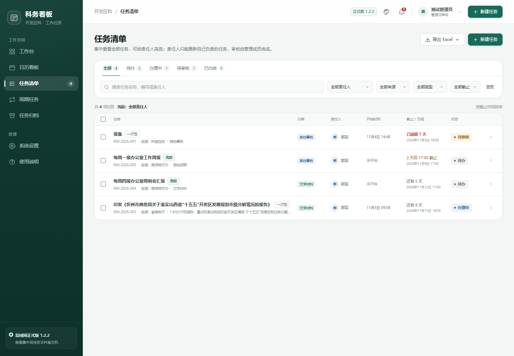
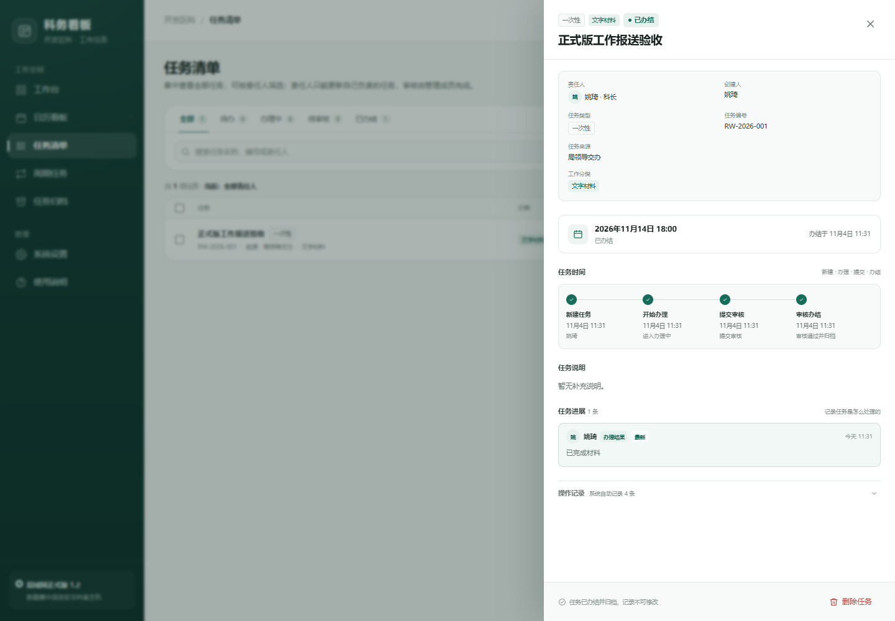
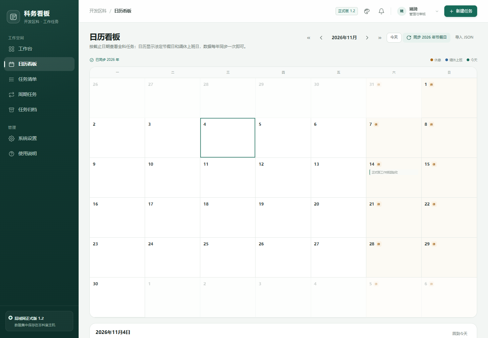

# 科务看板 1.2

开发区科内部工作任务看板，面向 5 人科室的局域网协同系统。Windows 主机双击运行后以**托盘程序**常驻，其他成员通过浏览器访问，数据集中保存在主机 SQLite 数据库中。

> 本项目为内部工作系统，公开仓库仅包含源代码、演示数据和文档，不包含实际业务数据库、备份文件或密钥。

[**下载 1.2 正式版（Windows EXE）**](https://github.com/yaoqi888/kewu-board/releases/latest)



## 功能

- 登录与权限：管理层/普通成员，首次登录强制改密，PBKDF2 密码哈希，CSRF 防护
- 任务办理：新建、编辑、开始办理、进展、提交审核、审核办结、退回重办
- 四节点时间轴：新建任务 → 开始办理 → 提交审核 → 审核办结
- 任务来源：市委市政府、省商务厅、局领导交办、其他单位、科室自定
- 工作分类：数据报表、文字材料、调研督导、会议活动、协调对接、其他事务
- 周期任务：按周、月、季度自动生成，历史期次独立保留
- 日历看板：按截止日期展示任务，显示法定节假日和调休上班日
- 年度节假日：内置 2026 数据，支持在线同步和 JSON 导入
- 任务删除：管理员单条/批量删除，30 天回收站
- 工作报送：任务归档页按上周/上月/自定义导出 Word 和 Excel
- Excel 导出：任务清单包含“任务进展”完整记录
- 数据备份：自动/手动快照、下载、恢复、上传恢复
- 托盘运行：无命令行黑窗，支持立即备份、打开数据目录、开机自启、退出
- 单实例、局域网访问、四套界面配色、响应式布局





## 技术栈

- Python 3.11+ / Flask / Waitress
- SQLite（WAL）、服务端会话、CSRF、PBKDF2
- 原生 HTML/CSS/JavaScript 前端，无前端构建依赖
- 自研无依赖 XLSX / DOCX 导出
- pystray + Pillow Windows 托盘
- PyInstaller 单文件 EXE

## 目录

```text
server/
  app.py                  Flask/Waitress 服务端、权限、备份、托盘入口
  schema.sql              SQLite 表结构
  holidays-2026.json      内置 2026 节假日数据
  static/
    index.html
    assets/
      app.js
      styles.css
      xlsx.js
      docx.js
      holidays.js
docs/
  首次部署说明.md
  正式版1.2发布说明.md
  正式版技术方案.md
  screenshots/
```

## 本地运行

```powershell
python -m venv .venv
.venv\Scripts\Activate.ps1
pip install -r requirements.txt

$env:KEWU_DATA_DIR="$PWD\server\devdata"
$env:KEWU_PORT="5080"
$env:KEWU_CONSOLE="1"
python server/app.py
```

浏览器打开 `http://127.0.0.1:5080/`。

首次启动内置 5 个账号，初始密码为 `Kewu@2026`，首次登录必须修改。正式部署请阅读 [首次部署说明](docs/首次部署说明.md)。

## 构建 EXE

先准备应用图标 `build-assets/kewu.ico` 和版本信息 `build-assets/version_info.txt`，然后：

```powershell
pyinstaller --noconfirm --clean --onefile --windowed `
  --name "科务看板" `
  --icon "$PWD/build-assets/kewu.ico" `
  --version-file "$PWD/build-assets/version_info.txt" `
  --add-data "$PWD/server/static;static" `
  --add-data "$PWD/server/schema.sql;." `
  --add-data "$PWD/server/holidays-2026.json;." `
  --add-data "$PWD/build-assets/kewu.ico;." `
  --collect-all waitress --collect-all pystray `
  --distpath "build/dist" --workpath "build/work" --specpath "build" `
  "server/app.py"
```

生成 `build/dist/科务看板.exe`。双击后驻留任务栏通知区，不显示命令行窗口。

## 数据与备份

```text
data/
  kewu.db
  backups/
  logs/
  secret.key
```

- 默认每 24 小时自动备份，最多 40 份
- “系统设置 → 数据与备份”支持立即备份、下载、恢复
- 迁移时完整复制 EXE 和 `data/`
- 不要把 `data/`、`server/devdata/`、`server/testdata/` 提交到 Git

## 网络

- 默认端口 `5080`
- 主机和成员电脑需在同一局域网
- 首次部署用管理员权限放行 Windows 防火墙 TCP 5080
- 二级路由器跨网段时，需要在主机路由器做 5080 端口映射，或把路由器改为 AP 模式
- **不要将 5080 暴露到互联网**

## 节假日数据

节假日/调休数据来自年度 JSON（`holiday-cn` 格式），不依赖 `chinese-calendar` 的库版本。内置 2026 数据；后续年份可在日历页手动同步，或导入年度 JSON。没有外网时仍可手动导入。

## 安全说明

- 登录密码使用 PBKDF2，服务端不保存明文
- 会话 Cookie HttpOnly、SameSite=Lax，12 小时过期
- API 写操作校验 CSRF 和 Origin
- 任务状态由服务端校验，普通成员不能修改他人任务
- 删除为软删除，30 天内可恢复
- 备份和恢复仅管理员可操作
- 本项目面向受信任局域网，不提供公网暴露所需的 WAF、MFA 等能力

## 版本

- 1.0.0：正式版基础功能
- 1.1.0：开始时间、任务来源、工作报送、管理员自审、新默认分类
- 1.2.0：日历看板、调休、删除回收站、四节点时间轴、Excel 任务进展、托盘运行

## 说明

演示数据和截图中的姓名仅用于界面展示。实际部署时请使用本科室真实账号，并在首次登录后修改所有初始密码。


